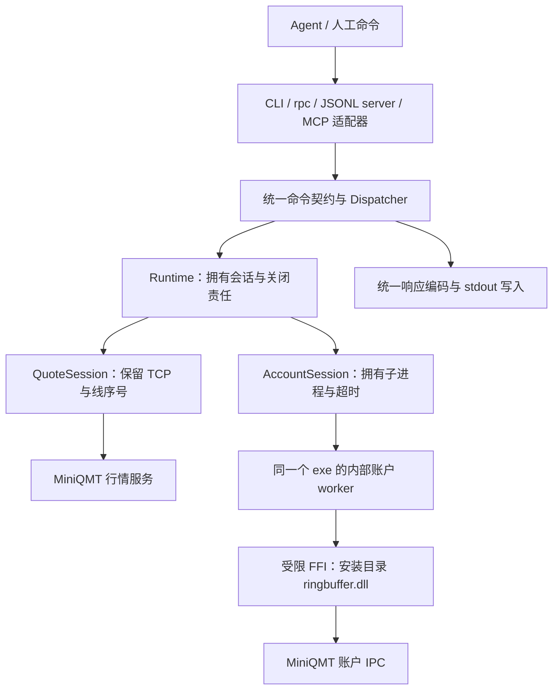

# 可用 Rust QMTCLI：架构审查与交付候选

审查日期：2026-11-01。依据版本：`a42c322939a53c7ce2a6985b970c643a4f3754cd`。
读者动作：审查并选择首版结构；本文件为决策前设计，依附当前 OpenSpec，不是新计划系统。
作者为本次 agent，自评；没有独立审查者，不宣称外部架构评审通过。

## 判断与选择

[K] 已有 Rust 行情库、Python 原生账户 IPC 和稳定的 agent JSON 契约可复用。
但现有 Rust 可执行文件仍是一次性行情查询，尚不能当作 Rust QMTCLI 产品交付。
账户原生路径调用私有 C++ DLL，并通过子进程隔离，不是纯 Rust 共享内存实现。

用户已明确先交付可用 Rust 版，并在实现前审查架构。公开接口、包划分及账户
隔离方式是待选的结构决定，以下推荐仍是候选，不代表用户已批准全部实现细节。

| 候选 | 与首版目标的关系 | 代价及故障边界 | 改回来的具体成本 |
|---|---|---|---|
| A：最小改动，Python QMTCLI 调 Rust 行情库/子进程 | 最快保留现有完整能力，但仍需要 Python，只能称混合实现 | 两个运行时，账户维持现状 | agent 入口不变，撤回 Rust 行情适配即可，无数据迁移 |
| B：Rust 主程序内直接调用账户 DLL | 一个运行时，进程较少 | 未受控 C++ 调用可能挂死/崩溃主程序；线程超时不能强制中止调用 | 外部 JSON 无需改，但必须把 FFI、句柄及所有权重新移入子进程，重做故障测试 |
| C：Rust 主程序＋同一 exe 的隔离账户 worker（推荐） | 无 Python，复用已验证的账户隔离方式；行情由主进程直接连接 | 多一个由父进程拥有的进程与内部协议；账户仍依赖安装目录的匹配 DLL | 调用方保持受支持的 JSON 子集；可切回 Python exe，或重做 worker 内部实现，无数据格式迁移 |

[I] 推荐 C：先解决可运行与故障隔离，再消融局部性能。若账户 ABI 无法在 Rust
复现，则 C 的账户交付被阻挡；可单独交付明确标注的 Rust 行情版，或另行选择 A。
不能悄悄用 Python worker 填补后仍称纯 Rust。若以后有已验证的无 DLL 账户传输，
可以替换 worker 内部实现，保留 agent 契约。

## 已核实的现状

| 事实 | 代码证据 | 对本轮的含义 |
|---|---|---|
| Rust CLI 一次读取后退出 | [main.rs](../../../experiments/native-quote-rs/src/main.rs)，`QuoteClient::get_full_tick` | 外部没有常驻 JSONL、发现命令、请求 id，也没有账户入口 |
| Rust 库有单所有者 QuoteSession | [lib.rs](../../../experiments/native-quote-rs/src/lib.rs)，`connect` / `QuoteSession::get_full_tick` | 可直接复用已有会话，不需要另写行情协议 |
| 版本校验、返回代码扫描及克隆在库中 | 同文件 `validate_runtime`、`selected`、`result.clone()` | 不是编译器能自动消除的架构成本；优化不得删除校验 |
| 账户 IPC 是 ctypes 调券商 C++ 导出 | [native_asset.py](../../../src/qmtcli/native_asset.py)，`_Ring`、`_WorkerConnection` | 去掉 CPython SDK 不等于去掉券商 DLL；Rust FFI 仍待移植验证 |
| 账户已有持久 worker、请求相关性和父超时 | [native_session.py](../../../src/qmtcli/native_session.py)，`_start/query/close` | 复用故障模型和负控，不把 DLL 放进主进程 |
| 原生四项快照有明确非原子元数据 | [cli.py](../../../src/qmtcli/cli.py)，`_native_snapshot`，行 1943 | 迁移字段及语义，不能凭一次响应宣称原子快照 |
| Python server 复用 AccountSession | 同文件 `_server`，行 2232 | JSONL 的进程/会话生命周期是首版可用性的主要参照 |
| MCP 调用未传 AccountSession | [mcp_server.py](../../../src/qmtcli/mcp_server.py)，行 144 | `_handle_rpc_request` 默认参数为 None；native snapshot 会创建并关闭临时会话，不能假定 MCP 已有同等复用 |
| 发现与多入口已有关联 | `cli.py` 的 AGENT_CAPABILITIES，MCP `build_tool_specs` | 保留单一能力来源，避免四套命令分发表 |

这些是静态代码事实，不表示相应 Rust 产品已经运行。读取的代表性历史包括
`dd9d8dc`（持久账户 worker）、`eb6b13d`（四项原生快照）、`dc2db68`（native 行情
入口）、`4a8580f`（Rust 会话）；用于核对演化边界，未做全仓热点/复杂度统计。

## 会阻挡首版交付的问题

1. **账户 FFI 尚未移入 Rust（必须先验证）。** 当前 `_Ring` 使用 MSVC 修饰名、
   opaque 指针、隐藏返回地址、内存映射和券商对象生命周期。复用 Python 中的
   字节布局证据，不等于 Rust ABI 已正确；GNU Rust 行情能运行也不证明账户 FFI
   能运行。先在自有 fixture 和隔离进程中核实 ABI、失败清理，再连真实服务。
   不在 Rust 分配器中释放券商分配的对象，不凭猜测增加 C++ 析构调用。
2. **产品入口缺失。** 当前 main 一次创建 QuoteClient 并查询；若直接包一层
   循环仍调用便利方法，每行都重连和重验文件。应由进程级 Runtime 持有会话。
3. **兼容范围未冻结。** 旧 Python RPC 默认 backend=sdk，而首版 Rust 候选只
   有 native；不能静默宣称整个 API 等价。受支持调用应复用现有显式
   `backend:native` 请求；SDK 及尚未迁移命令明确失败，capabilities 只列已实现项。
4. **跨入口生命周期不统一。** 从旧 MCP 调用原样移植会保留每次新会话的行为。
   CLI/rpc 为短生命周期，server/MCP 为各自进程内的长生命周期，均调用同一
   Dispatcher/Runtime；不同进程之间不宣称共享连接。
5. **回放性能不是发布验收。** 现有回放不能代替真实 Rust 长连接、账户四项
   查询、端到端 JSONL 和净机依赖检查。用户当前大 QMT 服务不可用的限制仍保留。

## 推荐结构（候选）

[I] 一个产品 crate，模块按当前责任划分，不先建多包插件框架：

| 模块责任 | 应拥有的状态/规则 | 不能承担的责任 |
|---|---|---|
| `agent_api` | 请求 id、命令/别名、输入检查、响应 envelope、能力清单 | DLL 操作、连接池或隐式 SDK 回退 |
| `runtime` | 每进程一个当前行情会话和一个当前账户会话；按路径/端口/账户类型切换 | 把快照当事件，隐式重放失败查询 |
| `quote` | 现有 framing/CRC/BSON、心跳分流、查询序号、失败后关闭 | agent JSON 包装、账户 IPC |
| `account` | 记录解码、请求/响应状态机、worker 监督 | 借用 SDK 的进程或任意调用 DLL |
| `account/ffi` | 固定版本导出、opaque 句柄、映射、声明过的账户只读操作 | 外部命令分派和交易写入 |
| `output` | 一次 JSON 编码、单 writer、stdout 协议与 stderr 诊断分开 | 将内部 worker 日志混入公共输出 |

这些是模块候选，不要求现在创建对应文件。产品化时将现有 Rust 行情实现迁入
产品 crate，保留其测试和历史；实验目录只保留适配/基准，不维护第二份 wire。
Python 在迁移验收前保留。依赖版本、CLI/MCP 库须在实施时核实官方契约，
本轮不新增依赖、不安装工具、不将新检查接入构建。

## 首版行为与故障契约

- 候选必须能力：`capabilities/schema/examples/status/doctor`、`full-tick`、
  `asset/positions/orders/trades/account-snapshot`、`rpc`、JSONL `server`。
  首个可运行片段可只开放行情；账户未验收时不在发现中标记可用。
  MCP 作为同一 Runtime 的薄适配单独验收；是否纳入首个安装包仍是范围选择。
- 沿用成功 `ok/data`、失败 `ok/error` 和请求 id 回显；对齐现有 native 示例、
  命令别名及参数。数据 id/时间戳/数量不经 f64 中转；价格保留既定浮点语义。
  空列表、空行情、错误和不支持必须区分。
- 继续要求显式 native 业务请求，不静默改变 sdk 默认的含义；若选择新的默认，
  须作为公开契约变化单独确认。发现命令不应为运行而加载账户 DLL 或要求登录。
- `status/doctor` 区分版本匹配、服务可达、账户验证及行情时间戳；端口开着
  不等于账户登录成功，缓存快照不等于实时推送。
- QuoteSession 与账户 worker 都是单所有者；首版每个外部进程顺序处理请求。
  连接复用但结果每次新查。换路径/账户/类型关闭旧 worker；不要无限建会话池。
- 超时/崩溃/坏帧：当前请求失败、丢弃所属会话；后续请求可建立新代际，失败
  请求不自动重放。wire sequence、内部 worker request id、会话 generation
  分别匹配，不用请求序号冒充账户事件序号。
- DLL 阻塞由父进程截止时间监督；只终止本程序拥有的 worker，不停止 QMT。
  EOF、父进程退出及启动半失败均要清理 worker；用受限继承句柄和进程所有权
  机制验证孤儿进程退出，不依靠 Rust Drop 能在任意父崩溃时运行的假设。
- 四项快照按现有顺序读取，标记 atomic=false、开始结束时间和 native_generation。
  任一节失败不伪造空结果，元数据字段及其含义用 golden fixture 固定。
- 账户记录按已验证的字节偏移和大小解码，不直接把未对齐字节转换成 Rust
  结构体引用。回复队列先独占创建并验证随机 owner/session 标记，失败清理只
  涉及本程序拥有的 down_queue，不能截断/删除共享 up_queue 或他人回复队列。
- worker 内部可以先用有界 JSONL 复用现有父子相关性模型；这是实现协议，不是
  公开 API。限长、限行、超时和 stdout 单 writer 必须一起测试。
  因此不能宣传“整个系统只序列化一次”；先测实际账户边界，再决定是否改二进制。
- MCP 有自己的外层协议，不能把自定义 JSONL server 当成 MCP；共享的是
  Dispatcher 和会话所有权，MCP 适配实现仍要遵循对应官方契约。
- 首版只接受已验收的 MiniQMT Windows x64/STOCK/版本指纹。历史、竞价、行情
  增量订阅、账户事件迁移、大 QMT 和交易写入不隐式进入能力清单。

## 性能安排

[K] 既有回放已验证连接复用收益；Rust 1.99.1 没有稳定的升级收益。
[I] 优先从入口保证复用，再隔离优化 `selected` 的线性匹配和 BSON 克隆。
匹配优化必须保留显式代码/市场选择器/无关返回拒绝语义；不得直接删除检查。
每次只改一项，端到端与组件同测，不先固定 500 条默认或引入并发。
文件指纹在会话建立时验证，活跃会话的版本绑定有明确生命期；不要引入全局
永久“已验证”缓存。额外的加载/探测时间沿用或明确标注现有超时口径。

## 分片交付与回退（设计候选）

| 片段 | 可核对的结果 | 回退点 |
|---|---|---|
| 1. 合同与命令入口 | 受支持 native 请求的 golden fixtures；发现/错误/id；CLI/rpc/server 共同分派 | 新 exe 使用独立名称，agent 切回原 Python 命令，无数据迁移 |
| 2. 行情可用版 | JSONL 连续 40 次查询只认证一次、结果新读；CRC/心跳/EOF/超时；真实 idle 接受 | 保留原 Rust 实验和 Python，未证明前不替换默认入口 |
| 3. Rust 账户 ABI 与隔离 | 自有映射/导出探针、worker 可启动/终止、错版本失败；故意挂起/崩溃仅影响 worker | 未通过则关闭账户能力发布，不以 Python 填补“纯 Rust”声明 |
| 4. 账户四项闭环 | 同账户连续 40 次 snapshot 一个 worker；账户切换；非空/空/错账户/半包/迟到帧；与 SDK 字段对账 | 只切回独立旧命令，不改券商缓存和共享队列 |
| 5. 分发与 MCP（若选入） | 无 Python 环境的干净启动；MCP 同会话复用；完整 EOF/父异常清理；二进制/依赖清单与版本 | 原安装入口保留，回退新 exe/MCP 启动配置 |

每片证据进入本 OpenSpec；性能回放不代替第 2/4/5 片的实际入口验收。
实现每片都核对没有新增第二份协议、未把 FFI 移入主进程、未扩大只读范围。

## 触达资产与未知

| 资产 | 本轮关系 | 风险、验证和回退 |
|---|---|---|
| `experiments/native-quote-rs` | 只读审查；后续产品库迁移候选 | wire 保持单一来源，迁移前后复跑原 fixture；原入口保留到验收 |
| `src/qmtcli` | Python 契约/状态机/ABI 的证据来源，本轮未改 | Rust 对照后迁移，不从字段猜业务含义；Python 回退不涉及数据迁移 |
| 用户 QMT 安装和运行实例 | 本轮未操作，未来只读服务及账户 DLL 使用 | 账户仍需匹配的券商 DLL；不打包/分发券商软件、不修改能力授权或登录 |
| Rust 分发 exe | 尚未交付，独立名称候选 | PE/依赖清单和无 Python 环境验收；不能覆盖旧 qmtcli 后才发现缺命令 |

[K] 现有行情 exe 的 PE 静态导入仅见 Windows 系统 DLL（kernel32、msvcrt、ntdll、
userenv、ws2_32、bcryptprimitives 及同步 API set），不见 Python/券商 DLL。
这只说明该行情产物的静态导入，不能替代未来账户 worker 的动态依赖验收。

尚未证明：Rust 账户 ABI、真实持久行情会话、跨入口性能、MCP Rust 实现、
大 QMT 可用性、干净机器可分发性。用户需选择：是否采用 C，以及 MCP 是否必须
与首个安装包同步。其余建议依赖该选择；本轮没有开始生产迁移。

## 本轮检查

Code Intel normal 在审查前的冻结源码上 PASS/completed：
`C:/Users/Administrator/AppData/Local/code-intel/artifacts/qmtcli-account-session-stream/1793541903515-79844-core/run-complete.json`。
执行了上述定向源码/代表性历史检查和现有产物 PE 导入检查。未运行新的性能
实验、真实账户查询或单元测试；没有更改代码，不把结构检查当作产品验收。
文档只承载本 OpenSpec 的设计候选，不另建 tracker、KB 真相或第二套计划。
工作区标准文件 `F:/projects/_standards/repo-standard.md` 和 `_standards/kit`
本轮复核仍缺失；沿用现有 AGENTS/OpenSpec 规则，不声称符合缺失的模板标准。
